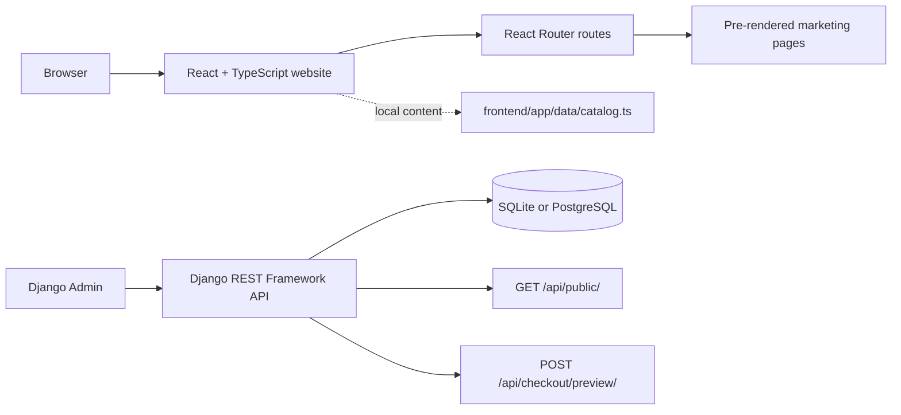

# DemoSuite — Website Demo for a Fictional WordPress Plugin

DemoSuite is a full-stack portfolio demo of a marketing website for a fictional WordPress plugin. **This repository contains the website demo, not an installable WordPress plugin.** It combines a **Django REST Framework API** with a **React, TypeScript, and React Router** frontend to demonstrate product pages, documentation, editorial content, search, pricing, and a simulated checkout.

The project is designed to show practical experience building a responsive web product across Python and JavaScript: Django models and API endpoints, server-rendered and pre-rendered React routes, SEO metadata, reusable UI, and server-side pricing calculations.

> **Demo only:** DemoSuite, its integrations, reviews, portraits, product screenshots, pricing, and legal copy are fictional examples. The checkout does not collect payment information and does not process transactions.

## Project highlights

- **WordPress plugin marketing site:** homepage, feature catalog and detail pages, integrations, pricing comparison, customer-story examples, FAQ, documentation, blog, and policy pages.
- **SEO-oriented frontend:** React Router server rendering and pre-rendering for marketing routes, page-specific titles and descriptions, plus `robots.txt` and `sitemap.xml` files to configure for a real domain.
- **Searchable documentation:** filter guides by title and summary, with URL query state for shareable searches.
- **Django REST API:** public content endpoint and a pricing-preview endpoint built with Django REST Framework.
- **Pricing rules:** Python `Decimal` arithmetic, input validation, quantity limits, and multi-site discount tiers.
- **Content management:** Django Admin models and a seed command for fictional public content.
- **Responsive interface:** React components, custom CSS, Lucide icons, and illustrated WordPress admin previews.
- **Regression coverage:** focused end-to-end checks for the pre-rendered routes and key page behavior.

## Technology stack

| Area | Technologies |
| --- | --- |
| Backend | Python 3.11+, Django 5.2, Django REST Framework |
| Database | SQLite for local development; PostgreSQL support through `DATABASE_URL` |
| Frontend | React 19, TypeScript 5.8, React Router 7, Vite 6 |
| Styling and icons | Tailwind CSS 4 tooling, custom CSS, Lucide React |
| Local orchestration | Docker Compose |
| Frontend checks | Node.js test runner, Prettier |

## Architecture



The frontend is built and pre-renders the configured routes. The Django API and content models are available as a separate backend. **The frontend catalog is currently maintained in `frontend/app/data/catalog.ts`; there is not yet an automated content export or synchronization step from Django Admin to the static frontend.** This makes the current data boundary explicit and keeps the static build deployable without a running Node server.

## Run locally

### Requirements

- Python 3.11 or newer
- Node.js 22 or newer and npm
- Docker Compose is optional

### 1. Set up the Django API

From the project root:

```bash
python3 -m venv .venv
source .venv/bin/activate
python -m pip install -r backend/requirements.txt
cd backend
python manage.py migrate
python manage.py seed_demo
python manage.py runserver
```

The API runs at `http://127.0.0.1:8000`. To manage sample content, create a local admin account and open `http://127.0.0.1:8000/admin/`:

```bash
python manage.py createsuperuser
```

### 2. Run the React frontend

In a second terminal, from the project root:

```bash
cd frontend
npm ci
npm run dev
```

Open `http://localhost:5173`.

### Optional: Docker Compose

From the project root:

```bash
docker compose up --build
```

This starts the Django development server and Vite frontend. The first run installs dependencies inside the containers.

## API examples

### Read published demo content

```http
GET http://127.0.0.1:8000/api/public/
```

The response contains published content, brand settings, and a `fictional` flag. It is a public endpoint; do not put credentials or private content in its response.

### Preview a pricing quote

```bash
curl -X POST http://127.0.0.1:8000/api/checkout/preview/ \
  -H 'Content-Type: application/json' \
  -d '{"plan":"annual","quantity":5}'
```

The endpoint validates the plan and quantity and returns a USD quote. A five-site annual example applies the configured 5% volume discount. This is a pricing preview only; it is not connected to a payment provider.

## Build and checks

Build the frontend and generate its pre-rendered routes:

```bash
cd frontend
npm run build
```

Run the focused frontend route checks after building:

```bash
npm run test:e2e
```

Check formatting:

```bash
npm run format:check
```

The production build writes deployable frontend assets under `frontend/build/`. Configure static hosting or a CDN to serve each pre-rendered route correctly. The project has not been measured against production Lighthouse or field Core Web Vitals data.

## Search engine and launch checklist

Before deploying a rebranded site:

1. Replace the fictional brand, features, integrations, customer stories, portraits, blog content, screenshots, prices, and legal language with verified information.
2. Replace the example host in `frontend/public/robots.txt` and `frontend/public/sitemap.xml` with the production domain.
3. Add and verify canonical URLs and social-sharing metadata for the production domain.
4. Confirm that each page title and description matches its real content and search intent.
5. Configure production environment variables, allowed hosts, and `DEBUG=false`; never deploy with the local development secret key.
6. Connect a payment provider only through a secure backend flow. The current checkout is simulated and does not take payments.
7. If Django is the content source for the frontend, implement and document the export/build synchronization step before publishing content through Admin.

## Useful files

```text
backend/
  apps/content/                 Django content models, admin, API, and seed command
  apps/commerce/pricing.py      Server-side quote rules and discount tiers
  config/settings.py            Django configuration
frontend/
  app/routes/                   React Router page components
  app/data/catalog.ts           Current frontend demo content
  app/styles.css                Shared responsive design system
  public/                       Favicon, sample images, robots.txt, and sitemap.xml
  tests/site.e2e.mjs            Pre-rendered route regression checks
  react-router.config.ts        SSR and pre-render route configuration
```

## License

This project is licensed under the [MIT License](LICENSE). Third-party dependencies remain under their respective licenses.
